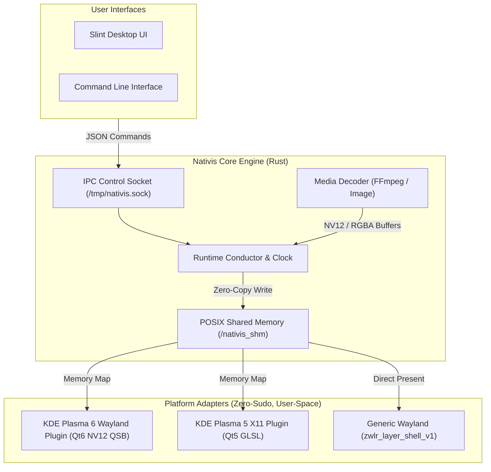

<div align="center">
  <h1>🌌 Nativis</h1>
  <p><b>High-Performance Cross-Platform Live Wallpaper Engine built with Rust</b></p>

  <p>
    <a href="https://github.com/ExiroStudio/nativis/releases"></a>
    <a href="LICENSE"></a>
    
    
  </p>
</div>

---

**Nativis** is a blazingly fast, multi-process multimedia live wallpaper engine engineered with Rust. Designed from the ground up for seamless, native operating system and desktop environment integration, Nativis avoids inefficient borderless window tricks by interfacing directly with native wallpaper layers and compositor protocols.

---

## ✨ Key Features

- **True Native Desktop Integration**: Injects directly into desktop shells (e.g., KDE Plasma 5/6) and Wayland compositors via `zwlr_layer_shell_v1` without drawing fake windows behind desktop icons.
- **Distro-Agnostic & Zero-Sudo Policy**: Runs and installs **100% in user-space** (`$HOME/.local/share/...`). Never asks for `sudo` and works identically across all Linux distributions (Ubuntu, Fedora, Arch Linux, openSUSE, Alpine, NixOS, etc.).
- **Ultra Low-Overhead IPC & POSIX SHM**: Leverages POSIX Shared Memory (SHM) buffers and dynamic ring-buffering for frame delivery, supporting buttery-smooth **4K 60FPS** playback.
- **Hardware-Accelerated Rendering Pipeline**: Video frames remain in multi-plane NV12 through the transport, decoded and composited on the GPU via custom WGPU and Qt Quick Scene Graph shaders.
- **Modern Desktop UI & Comprehensive CLI**: Control playback, settings, and library management via an intuitive Slint-powered GUI or scriptable CLI commands.
- **Single-Instance Background Daemon**: Background runtime maintains playback with atomic pause/resume triggers and IPC socket control (`/tmp/nativis.sock`).

---

## 🚀 Platform & Desktop Support

Nativis follows a strict **Platform Independence & Decoupling** model: core runtime and frame protocols remain completely platform-agnostic, with dedicated adapters for each desktop environment.

| Desktop Environment / Compositor | Display Server | Support Status | Integration Method | Sudo Required? |
|:---|:---|:---:|:---|:---:|
| **KDE Plasma 6** | Wayland | 🟢 **Stable** | Native Qt6 Wallpaper Package (`nativis-platform-kde-wayland`) | ❌ **No (User-Space)** |
| **Hyprland / Sway / River / COSMIC** | Wayland | 🟢 **Stable** | Native Layer Shell (`zwlr_layer_shell_v1`, `Layer::Background`) | ❌ **No (Direct Protocol)** |
| **KDE Plasma 5** | X11 | 🟢 **Stable** | Native Qt5 Wallpaper Package (`nativis-platform-kde`) | ❌ **No (User-Space)** |
| **GNOME Shell** | Wayland / X11 | 🚧 Planned | Dedicated GNOME Shell Extension (`nativis-platform-gnome`) | ❌ **No (User Extension)** |
| **Windows Desktop** | DWM | 🚧 Planned | Native `WorkerW` / `Progman` desktop hook | ❌ **No (User Session)** |
| **macOS** | Quartz | 🚧 Planned | Native AppKit `NSWindow` desktop layer | ❌ **No (User Session)** |

> 📖 **Platform Isolation Architecture:** Read our [Platform Independence & Isolation Policy](docs/PLATFORM_INDEPENDENCE.md) for architectural rules and isolation guarantees.

---

## 🎞️ Media Backend Support

| Media Format | Support Status | Hardware Accelerated | Notes |
|:---|:---:|:---:|:---|
| **Videos (MP4, MKV, WebM)** | 🟢 **Stable** | ⚡ Yes (GPU NV12 Shader) | Full H.264, VP9, and HEVC support up to 4K resolution. |
| **Images (PNG, JPG, WebP)** | 🟢 **Stable** | ⚡ Yes | Static images and photo wallpapers with auto-scaling. |
| **HTML5 / WebGL** | 🚧 Planned | — | Interactive web-based wallpapers. |

---

## 📦 Installation & Releases

### Download Pre-built Binaries
Grab the latest release from the [GitHub Releases](https://github.com/ExiroStudio/nativis/releases) page:
- **`nativis-linux-x86_64`**: Standalone single binary with pre-bundled FFmpeg decoders.
- **`nativis-linux-x86_64.tar.gz`**: Standalone binary bundled with pre-built desktop platform plugins for automatic KDE Plasma 5 & 6 bootstrap.

Simply extract and execute:
```bash
tar -xzf nativis-linux-x86_64.tar.gz
cd nativis
./nativis
```

---

## 🛠️ Building from Source

### 1. Prerequisites

Install the required build dependencies for your distribution:

**Fedora / RHEL:**
```bash
sudo dnf install gcc gcc-c++ cmake make nasm clang clang-devel \
    qt6-qtbase-devel qt6-qtdeclarative-devel qt6-qtshadertools-devel \
    wayland-devel mesa-libGL-devel mesa-libEGL-devel fontconfig-devel
```

**Ubuntu / Debian:**
```bash
sudo apt update
sudo apt install -y build-essential cmake pkg-config nasm clang libclang-dev \
    qt6-base-dev qt6-declarative-dev qt6-shader-baker qt6-shadertools-dev \
    libgl1-mesa-dev libegl1-mesa-dev libfontconfig1-dev libfreetype-dev libwayland-dev
```

*(Optional for KDE Plasma 5 X11 builds: `qtbase5-dev qtdeclarative5-dev libqt5opengl5-dev`)*

### 2. Assemble Platform Bundles (KDE Plasma 5 & 6)
Nativis includes an `xtask` orchestrator to build native C++ QML plugins:

```bash
# Assemble KDE Plasma 6 Wayland bundle (Qt6):
cargo xtask bundle-kde-wayland

# Assemble KDE Plasma 5 X11 bundle (Qt5):
cargo xtask bundle-kde

# Or assemble all platform bundles simultaneously:
cargo xtask bundle-all
```

### 3. Compile the Nativis Binary
Build the standalone release binary (with pre-bundled FFmpeg for full codec support):
```bash
cargo build --release --bin nativis --features nativis-plugin-video/bundle-ffmpeg
```

The resulting binary will be available at `target/release/nativis`.

---

## 🎮 Usage & CLI Commands

### Graphical User Interface (Default)
Running `nativis` without arguments automatically bootstraps the background daemon and opens the modern GUI:
```bash
nativis
```

### Direct Wallpaper Launch
Apply a video or image wallpaper directly from your terminal:
```bash
# Set a video wallpaper (automatically routes to KDE Wayland, KDE X11, or Generic Wayland)
nativis /path/to/wallpaper.mp4

# Set an image wallpaper
nativis /path/to/picture.jpg
```

### CLI Control & Automation
When the daemon is running, control playback seamlessly from scripts, shortcuts, or keybindings:

```bash
# Check daemon status, platform adapter, and active wallpaper
nativis status

# Pause playback (drops CPU/GPU consumption to 0.0%)
nativis pause

# Resume playback
nativis resume

# Stop background daemon
nativis stop

# Restart daemon with saved configuration
nativis restart

# Run daemon headlessly (ideal for systemd user services or autostart)
nativis --no-gui
```

---

## 🧩 Architecture Overview



---

## 📄 License

Licensed under:
- Apache License, Version 2.0 ([LICENSE](LICENSE))