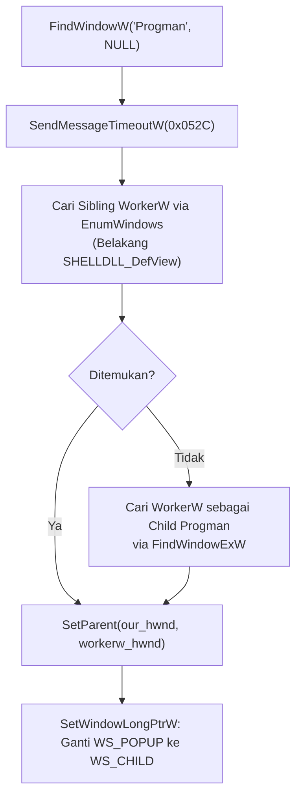
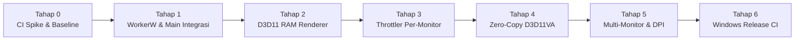

# Nativis Windows Platform Architecture & Performance Plan (Revised v2.1)

Dokumen ini merinci rencana teknis, arsitektur, dan strategi implementasi untuk platform **Windows (`nativis-platform-windows`)** setelah evaluasi arsitektural dan koreksi menyeluruh terhadap celah teknis (zero-copy D3D11VA, integrasi main binary/IPC, dual-topology WorkerW Windows 11, deteksi fullscreen akurat, spike CI/FFmpeg, serta **eliminasi kode Linux untuk minimalisasi ukuran binary `.exe`**).

---

## 1. Prinsip Desain & Target Metrik Realistis

Berdasarkan analisis teknis (footprint driver vendor GPU DirectX, surface 4K, dan decoding runtime), target metrik disesuaikan dari asumsi teoritis ke target operasional yang terukur:

| Aspek | Estimasi Realistis Nativis | Catatan Teknis & Mitigasi |
| :--- | :--- | :--- |
| **CPU Usage (1080p 60fps)** | **< 0.5% – 1.0%** | Demuxing ringan + HW decoding (D3D11VA). |
| **CPU Usage (4K 60fps)** | **1.0% – 3.0%** | Demuxing kontainer 4K bit-rate tinggi + submit batch ke driver D3D11. |
| **CPU Usage (Paused / Game)** | **0.00%** | Thread decode & render freeze seketika (no `Present()`). |
| **RAM (Working Set)** | **60 MB – 110 MB** | Termasuk driver DLL GPU (nvldumdx/amdxx), FFmpeg state, dan swapchain surface. |
| **RAM saat Paused/Idle** | **< 30 MB** | Pemanggilan `SetProcessWorkingSetSize(-1, -1)` saat pause/sleep untuk trim working set. |
| **Compositing Model** | **DWM Composited (Flip Discard)** | Child window WorkerW tetap dikomposisi DWM (bukan DirectFlip bypass), namun `DXGI_SWAP_EFFECT_FLIP_DISCARD` meminimalkan latensi dan konsumsi VRAM (2-buffer ring). |
| **Ukuran Binary `.exe`** | **Minimal & Ramping** | Seluruh kode & aset Linux (KDE, Wayland, POSIX SHM, `.so`) **dieliminasi total** via conditional compilation. |
| **Single Executable** | **Target Utama** | Single binary portable tanpa installer atau dependensi DLL eksternal runtime. |

---

## 2. Solusi untuk Celah Teknis Utama

### 2.1. Zero-Copy VRAM Pipeline (Tahap 4)
Pada arsitektur saat ini:
- `plugins/video_backend/src/lib.rs` memanggil `av_hwframe_transfer_data` yang menyalin frame hardware ke RAM, lalu `Arc::from(source.data(0))` menyalinnya kembali.
- `nativis-core/core/src/resource.rs` saat ini hanya mengenal `CpuBuffer` dan `PlanarBuffer` di RAM CPU.

**Solusi Arsitektural:**
1. **Ekstensi Abstraksi `Resource`**:
   Tambahkan resource tipe GPU handle yang aman dan downcastable via `Any`:
   ```rust
   // Di nativis-core atau nativis-platform-windows
   pub struct D3D11TextureResource {
       pub texture: windows::Win32::Graphics::Direct3D11::ID3D11Texture2D,
       pub subresource_index: u32,
       pub width: u32,
       pub height: u32,
       pub format: windows::Win32::Graphics::Dxgi::Common::DXGI_FORMAT,
   }
   ```
2. **Shared D3D11 Device Context**:
   FFmpeg tidak boleh mengalokasikan device DirectX terpisah. Decoder dan Renderer wajib berbagi satu `ID3D11Device` yang sama melalui `AVD3D11VADeviceContext`:
   - Sink membuat `ID3D11Device`.
   - Decoder mengikat device tersebut ke `av_hwdevice_ctx_alloc(AV_HWDEVICE_TYPE_D3D11VA)`.
3. **BindFlags & Multithreading**:
   - Frame pool decoder harus memiliki flag `D3D11_BIND_SHADER_RESOURCE` agar tekstur NV12 dapat langsung di-bind sebagai Shader Resource View (SRV).
   - Mengaktifkan proteksi multithread pada device context:
     ```rust
     let multithread: ID3D11Multithread = device.cast()?;
     multithread.SetMultithreadProtected(true);
     ```
     Ini menjamin thread decoder (background) dan thread presenter (sink) tidak mengalami race condition saat mengakses pipeline D3D11.

---

### 2.2. Integrasi Main Binary & IPC Windows (Tahap 0 & 1)
- **Kompilasi Workspace Bersih**:
  Seluruh crate baru di `nativis-platform/windows/` diberi `#![cfg(windows)]` agar perintah `cargo check --workspace` di Linux tetap berjalan normal.
- **IPC Abstraction (Named Pipe)**:
  `UnixListener` dan `UnixStream` tidak tersedia di Windows.
  - Tambahkan implementasi Windows IPC berbasis **Named Pipe (`\\.\pipe\nativis`)**:
    - Server: `CreateNamedPipeW` / `ConnectNamedPipe` atau crate asynchronous lightweight.
    - Client: `CreateFileW` / `CallNamedPipeW`.
  - Protokol payload tetap sama persis: JSON baris per baris (`IpcCommand` & `IpcResponse`).
- **Main Routing & Platform Selection**:
  Pada `src/main.rs`:
  ```rust
  #[cfg(target_os = "windows")]
  fn create_platform() -> Box<dyn Platform> {
      info!("Selected Windows Platform Adapter (WorkerW Desktop Injection & D3D11)");
      Box::new(WindowsPlatform::new())
  }
  ```
  Hapus `panic!("Windows platform is not fully implemented yet")`.

---

### 2.3. Dual-Topology WorkerW (Windows 10, 11 23H2, dan 24H2+) (Tahap 1)
Pada Windows 11 24H2+, struktur hierarki jendela desktop dapat bervariasi: `WorkerW` bisa berada sebagai *sibling* dari `Progman` atau sebagai *direct child* di dalam `Progman`.

**Algoritma Pencarian Dual-Topology:**

Langkah setelah `SetParent`:
- Ubah *window style* secara eksplisit: hapus `WS_POPUP`, tambahkan `WS_CHILD`.
- Posisikan jendela mencakup seluruh area desktop virtual (`SM_XVIRTUALSCREEN`, `SM_YVIRTUALSCREEN`, `SM_CXVIRTUALSCREEN`, `SM_CYVIRTUALSCREEN`).

---

### 2.4. Smart Throttler yang Akurat (Tahap 3)
Menghindari bug batas offset jendela maximized (`x = -8, y = -8`) dan mendukung state monitor sleep:

1. **Deteksi Fullscreen via Shell API**:
   - Panggil `SHQueryUserNotificationState(&mut state)`.
   - Jika `state == QUNS_RUNNING_D3D_FULL_SCREEN` atau `QUNS_PRESENTATION_MODE`:
     $\to$ Aplikasi fullscreen/game 3D sedang aktif. Pause render instan ($0.00\%$ CPU).
   - Pasang WinEvent Hook (`SetWinEventHook`) untuk `EVENT_SYSTEM_FOREGROUND` agar deteksi perpindahan jendela terjadi secara event-driven (tanpa tight polling).
2. **Deteksi Monitor Sleep**:
   - `WTSRegisterSessionNotification` hanya menangkap lock/unlock session Windows.
   - Untuk monitor sleep, daftarkan:
     ```rust
     RegisterPowerSettingNotification(
         hwnd,
         &GUID_CONSOLE_DISPLAY_STATE,
         DEVICE_NOTIFY_WINDOW_HANDLE,
     );
     ```
     Saat `PBT_POWERSETTINGCHANGE` bernilai `0` (display off) $\to$ pause render loop dan panggil `SetProcessWorkingSetSize(GetCurrentProcess(), -1, -1)`.

---

### 2.5. Rendering D3D11 & Precompiled Shaders (Tahap 2)
- **Precompiled Bytecode**:
  Jangan mengompilasi shader HLSL saat runtime dengan `D3DCompile` (menghindari ketergantungan pada `d3dcompiler_47.dll` dan CPU overhead saat startup).
  - Shader NV12 $\to$ RGB dan RGBA dikompilasi saat build time (`fxc.exe` atau `build.rs`), lalu di-embed via `include_bytes!`.
- **Fitur Crate `windows` yang Dibutuhkan**:
  ```toml
  windows = { version = "0.58", features = [
      "Win32_Foundation",
      "Win32_UI_WindowsAndMessaging",
      "Win32_UI_HiDpi",
      "Win32_UI_Shell",
      "Win32_Graphics_Direct3D",
      "Win32_Graphics_Direct3D11",
      "Win32_Graphics_Dxgi",
      "Win32_Graphics_Dxgi_Common",
      "Win32_Graphics_Gdi",
      "Win32_System_Power",
      "Win32_System_RemoteDesktop",
      "Win32_System_Threading",
      "Win32_System_LibraryLoader",
      "Win32_Security",
  ] }
  ```

---

### 2.6. Isolasi Kompilasi & Eliminasi Kode Linux (Binary Size Stripping)
Agar file distribusi `nativis.exe` di Windows seringan mungkin, kode dan artefak khusus Linux **wajib dikeluarkan secara total dari proses kompilasi**:

1. **Target-Gated Dependencies di Root `Cargo.toml`**:
   Crate platform Linux dan POSIX SHM tidak boleh dimasukkan ke dalam dependency tree Windows:
   ```toml
   # Hanya dikompilasi untuk target non-Windows (Linux/FreeBSD)
   [target.'cfg(not(target_os = "windows"))'.dependencies]
   nativis-platform-kde         = { workspace = true }
   nativis-platform-kde-wayland = { workspace = true }
   nativis-platform-wayland     = { workspace = true }
   nativis-transport-shm        = { workspace = true }

   # Khusus Windows
   [target.'cfg(target_os = "windows")'.dependencies]
   nativis-platform-windows     = { workspace = true }
   ```
2. **Eliminasi Aset Biner Embedded Linux**:
   Pada platform KDE, binary Linux meng-embed shared library ELF (`libnativisplugin.so`, `libnativis_v2_core.so`, `libnativis_v1_core.so`, dan QML bundle) sebesar ~1.1 MB via `include_bytes!`. Karena crate `nativis-platform-kde*` tidak disertakan saat build Windows, seluruh file biner `.so` Linux ini **100% tidak akan masuk ke dalam `nativis.exe`**.
3. **Optimasi Profil Release Cargo**:
   Konfigurasi release profile di workspace `Cargo.toml` untuk memangkas *dead code* dan simbol:
   ```toml
   [profile.release]
   opt-level     = 3       # Optimasi kecepatan eksekusi
   lto           = "fat"   # Link-Time Optimization agresif lintas seluruh crate
   codegen-units = 1       # Memaksimalkan efektivitas LTO dan dead-code elimination
   panic         = "abort" # Menghilangkan tabel stack unwinding (menghemat ratusan KB)
   strip         = true    # Menghapus simbol debug dan string path sistem
   ```

---

## 3. Rencana Eksekusi Berurutan (Revised Roadmap)



### Tahap 0: Baseline & Keputusan Awal (Spike CI & IPC)
- **Tujuan**: Memastikan strategi build FFmpeg di Windows terbukti sebelum menulis kode platform yang rumit.
- **Aksi**:
  1. Spike build FFmpeg di Windows: Uji apakah `ffmpeg-next` dengan `bundle-ffmpeg` dapat dikompilasi di runner GitHub Actions Windows (`windows-latest`), atau apakah membutuhkan vcpkg / prebuilt static lib.
  2. Implementasikan abstraksi IPC Named Pipe di `nativis-core/ipc` yang kompatibel dengan UnixStream di Linux.
  3. Catat pengukuran baseline memori proses kosong dengan D3D11 device aktif di Windows.

### Tahap 1: Injeksi WorkerW & Integrasi Main Binary
- **Tujuan**: Binary `nativis` dapat di-build di Windows dan berjalan tanpa panic.
- **Aksi**:
  1. Buat crate `nativis-platform/windows/` dengan `#![cfg(windows)]`.
  2. Implementasikan dual-topology `WorkerW` hook (support Win 10 & Win 11 24H2+).
  3. Hubungkan `create_platform()` di `src/main.rs`.
  4. Hapus batasan `cfg(not(target_os = "windows"))` pada `nativis-plugin-video` jika backend video sudah siap dikompilasi di Windows.
  5. Verifikasi jendela kosong/warna solid dapat menempel di bawah icon desktop.

### Tahap 2: Renderer D3D11 dari RAM (`PlanarBuffer`)
- **Tujuan**: Menampilkan video bergerak pertama kali di desktop Windows menggunakan pipeline RAM yang stabil (meniru pola Wayland saat ini).
- **Aksi**:
  1. Buat `WindowsDirectSink` yang mengimplementasikan `FrameSink`.
  2. Siapkan `ID3D11Device`, `ID3D11DeviceContext`, dan `IDXGISwapChain1` (`DXGI_SWAP_EFFECT_FLIP_DISCARD`).
  3. Tulis vertex dan pixel shader NV12 $\to$ RGB (precompiled HLSL bytecode).
  4. Upload data `PlanarBuffer` (Y dan UV planes) ke dynamic/staging texture D3D11 lalu render.

### Tahap 3: Throttler & Power Management Per-Monitor
- **Tujuan**: Menghemat daya dan mencapai CPU $0.00\%$ saat user sedang beraktivitas lain, sebelum masuk ke optimasi zero-copy.
- **Aksi**:
  1. Integrasikan `SHQueryUserNotificationState` dan WinEvent Hook `EVENT_SYSTEM_FOREGROUND`.
  2. Pasang listener `RegisterPowerSettingNotification(GUID_CONSOLE_DISPLAY_STATE)`.
  3. Implementasikan per-monitor visibility: pause pembaruan frame jika desktop di monitor terkait tertutup penuh.
  4. Aktifkan working-set trim (`SetProcessWorkingSetSize(-1, -1)`) khusus saat state menjadi Paused.

### Tahap 4: Zero-Copy D3D11VA dengan Resource Baru
- **Tujuan**: Memangkas konsumsi RAM dan CPU ke batas terendah dengan menghilangkan transfer frame ke CPU RAM.
- **Aksi**:
  1. Tambahkan tipe resource GPU texture (`D3D11TextureResource`) ke ekosistem resource engine.
  2. Konfigurasi decoder hardware untuk berbagi satu `ID3D11Device` dengan renderer via `AVD3D11VADeviceContext`.
  3. Konfigurasi `D3D11_BIND_SHADER_RESOURCE` pada frame pool decoder.
  4. Pasang `ID3D11Multithread::SetMultithreadProtected(true)` untuk sinkronisasi thread decoding dan rendering.
  5. Hindari `av_hwframe_transfer_data`: operasikan pointer tekstur VRAM langsung ke shader.

### Tahap 5: Multi-Monitor & DPI Awareness Penuh
- **Tujuan**: Tampilan sempurna pada setup multi-monitor dengan perbedaan resolusi dan scaling.
- **Aksi**:
  1. Aktifkan `SetProcessDpiAwarenessContext(DPI_AWARENESS_CONTEXT_PER_MONITOR_AWARE_V2)`.
  2. Enumerasi monitor aktif via `EnumDisplayMonitors`.
  3. Dukung mode spanning virtual desktop (`SM_CXVIRTUALSCREEN`) atau multi-window per-monitor.

### Tahap 6: Release CI & Distribusi Single Executable Ramping
- **Tujuan**: Otomasi build release yang menghasilkan executable mandiri `nativis.exe` yang ramping dan bebas residu kode Linux.
- **Aksi**:
  1. Konfigurasi job matrix Windows di `.github/workflows/release.yml` menggunakan target `x86_64-pc-windows-msvc`.
  2. Pastikan build menggunakan profile `release` teroptimasi (`lto = "fat"`, `strip = true`).
  3. Validasi otomatis di CI:
     - Verifikasi ukuran file `nativis.exe` tetap ramping.
     - Verifikasi tidak ada simbol atau string dependensi Linux yang bocor ke dalam executable Windows (`nativis-platform-kde*`, `wayland`, atau SHM POSIX).
  4. Kompresi ke dalam `nativis-windows-x64.zip` yang hanya berisi satu file executable utama `nativis.exe`.
